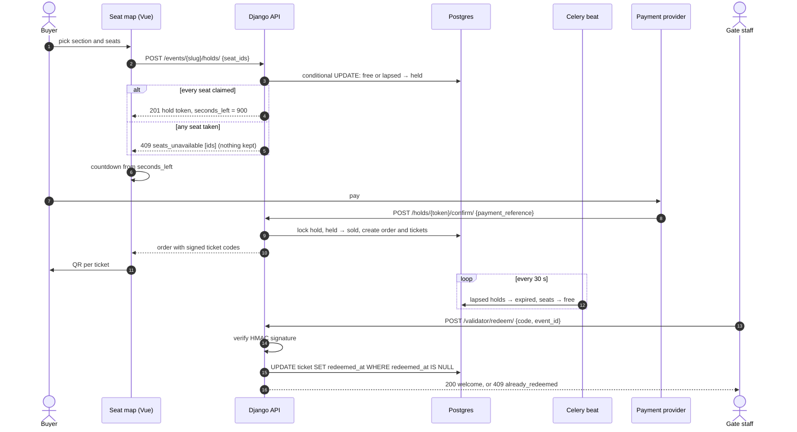

# ticketing-seat-hold

[](../../actions/workflows/ci.yml)

One slice of a ticketing platform: **seat map → 15-minute hold → payment confirmation → QR ticket → entry validation**.

It is taken from [vteatre.kz](https://vteatre.kz), a theatre-ticketing platform Markerloop built and ran in production. The original system is larger (catalogue, fan zones, offline sales, wallet and cashback, organiser tools). This repository rebuilds only the part where tickets can be double-sold or double-used, with a Django backend and a Vue 3 seat map.

**Live demo:** <https://showroom.markerloop.com/ticketing-seat-hold/>. The demo is the frontend running on its own with a mocked API (see [Frontend](#frontend)). Add `?hold_ttl=30` to the URL to watch a hold expire in 30 seconds.

## Flow



## Design decisions

**Why a hold with a TTL.** Payment takes minutes and some buyers walk away. Without a hold, two people could pay for the same seat and one of them would need a refund. If a hold never expired, abandoned checkouts would keep good seats off sale. Fifteen minutes (`SEAT_HOLD_TTL_SECONDS`) is enough to pay with a card and still short enough to bring seats back before a show. The client counts down from the server's `seconds_left` rather than `expires_at`, so a wrong clock on the buyer's device can't make the countdown longer or shorter than the real hold.

**How double-booking is prevented.** `place_hold` runs inside one transaction and claims seats with a conditional `UPDATE … WHERE status = 'free' OR (status = 'held' AND held_until <= now)`. It then compares the number of updated rows with the number of seats requested. If they differ, the transaction is rolled back, so a hold gets every seat it asked for or none of them. On Postgres, a second buyer's `UPDATE` waits for the first one to commit and then checks the condition again against the committed row, so it can't take a seat that was just claimed. Before the update, the rows are locked with `select_for_update()` in primary-key order, so two overlapping multi-seat holds can't deadlock. The database adds more guards behind this: `Ticket.event_seat` is one-to-one, a check constraint requires every held seat to have a hold, and `Order.payment_reference` is unique, so a callback that arrives twice returns the same order.

**Expiry needs no background job to be correct.** A seat whose hold has lapsed can be claimed straight away, because `held_until` is stored on the seat row. The Celery beat task (`release_expired_holds`, every 30 s) only tidies the data. It locks holds with `SKIP LOCKED`, so it never competes with a confirmation that is in progress or with another worker.

**Why the QR code is signed.** The QR holds `<ticket uuid>:<HMAC>`, made with Django's `Signer`. The gate rejects forged or mistyped codes before it touches the database, and nobody can find other tickets by changing an id. Key rotation works through `SECRET_KEY_FALLBACKS`. A ticket is redeemed with an update that only succeeds while `redeemed_at` is still empty. When two gates scan the same ticket at the same moment, exactly one of them admits the guest, and the other gets `409 already_redeemed` with the time of the first scan.

The tests cover these points. `tests/test_concurrency.py` and `test_two_gates_scanning_together_admit_one` start real threads with separate connections. They run on SQLite and on Postgres in CI. On Postgres, a version that checks the seat first and writes afterwards fails these tests.

## Layout

```
backend/    Django 5 + DRF + Celery
  ticketing/services/   holds, orders, tickets: all business rules live here
  ticketing/api/        thin DRF views; domain errors map to {code, detail} JSON
  tests/                pytest, including the concurrency tests
frontend/   Vue 3 + TypeScript + Vite
  src/components/       VenuePlan (SVG sections), SeatMap, HoldCountdown, TicketCard, GatePanel
  src/api/              typed client: HTTP or in-browser mock behind one interface
```

## Running

Full stack (Postgres, Redis, API, Celery worker and beat):

```bash
docker compose up --build        # API on :8000, seeds a demo event and prints the gate password
cd frontend && npm install
VITE_API_URL=/api npm run dev    # proxies /api to :8000
```

### Frontend

The frontend runs on its own: if `VITE_API_URL` is not set, it uses an in-memory mock API (`src/api/mock.ts`) that follows the backend's rules. Holds are all-or-nothing and expire after their TTL, a repeated payment confirmation returns the same order, and a ticket can be redeemed only once.

```bash
cd frontend && npm install && npm run dev                  # mocked API
BASE_PATH=/ticketing-seat-hold/ npm run build              # static build for a sub-path
BASE_PATH=/ticketing-seat-hold/ npm run preview            # serve dist/ at that path
```

## Tests

```bash
cd backend
python -m venv .venv && . .venv/bin/activate
pip install -r requirements-dev.txt
pytest                                   # SQLite
DATABASE_URL=postgres://… pytest         # Postgres
ruff check . && ruff format --check .

cd ../frontend && npm test
```

## Stack

Python 3.12, Django 5.2, Django REST Framework, Celery + Redis, PostgreSQL 16, pytest, ruff · Vue 3.5, TypeScript, Vite 6, Vitest, Vue Test Utils.

## License

MIT
